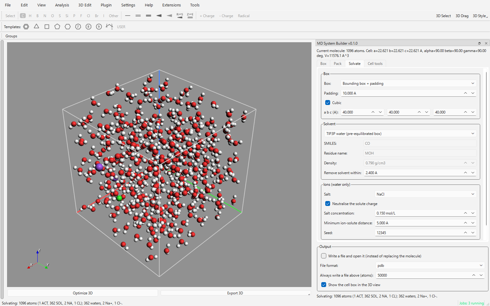
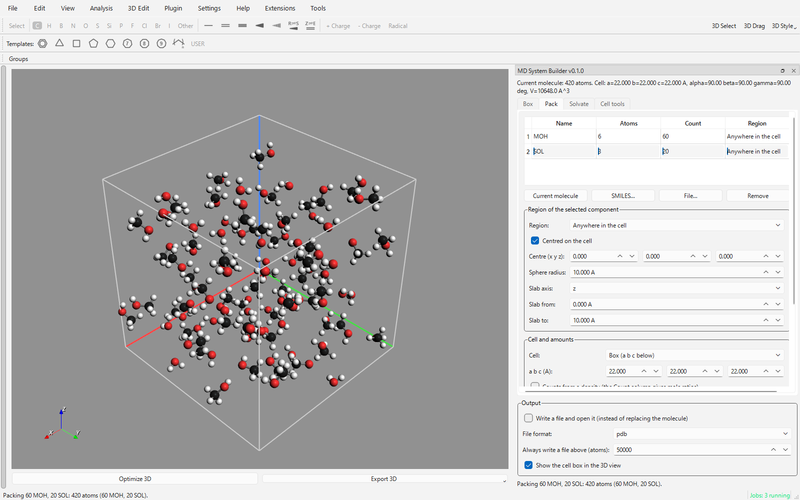
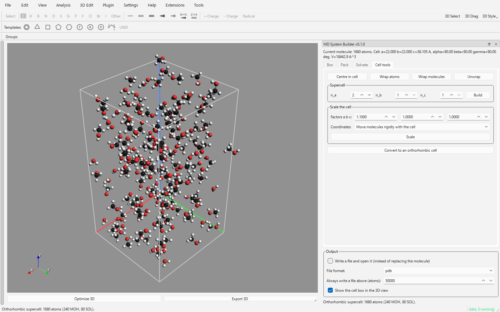

# MoleditPy MD System Builder

[](https://github.com/HiroYokoyama/moleditpy_md_system_builder/actions/workflows/test.yml)
[](https://github.com/HiroYokoyama/moleditpy_md_system_builder/tags)

A [MoleditPy](https://github.com/HiroYokoyama/python_molecular_editor) plugin that builds
periodic systems for molecular dynamics: set the cell, pack molecules into it, solvate
with water and ions, and edit the cell. It needs nothing beyond what MoleditPy already
installs (numpy, RDKit, PySide6, PyVista).



Open it from **Tools > MD System Builder...**. One dock panel holds four tabs, in the
order a system is built.

## Box

Sets the periodic cell of the current molecule from

- lengths and angles (a, b, c, alpha, beta, gamma; a along x, b in the xy plane),
- three cell vectors,
- the bounding box of the atoms plus a padding (optionally cubic),
- the structure open in the [CIF Viewer](https://github.com/HiroYokoyama/moleditpy_cif_viewer) panel,

or clears it. The atoms can be moved to the centre of the new cell.

## Pack

Packmol-like random packing, written in numpy:

- components from the current molecule, a SMILES string (3D-embedded with RDKit and
  cleaned up with MMFF/UFF) or a MOL/SDF/XYZ/PDB file;
- a count per component, or counts from a target density with the Count column read as
  mole ratios;
- a minimum distance between molecules (default 2.0 Angstrom), checked across periodic
  boundaries with a cell list, so the cost per trial does not grow with the box;
- uniformly random orientations and a reproducible seed;
- an optional fixed solute (the current molecule) centred in the box;
- per-component regions: inside or outside a sphere, inside or outside a slab;
- a retry limit: when random insertion fails that many times in a row the job stops and
  says how many molecules it placed and what to change.



## Solvate

- Box from a padding around the solute, explicit lengths, or the existing cell.
- Water from a pre-equilibrated TIP3P box (216 molecules, 0.997 g/cm3) tiled into the
  cell, triclinic cells included. Waters whose oxygen falls outside the cell or too close
  to another water across a periodic boundary are dropped; tiled boxes come out at
  0.97-1.00 g/cm3. The box was generated for this plugin by
  [`tools/generate_water_box.py`](tools/generate_water_box.py) (rigid TIP3P Monte Carlo,
  first O-O peak at 2.75 Angstrom); no third-party coordinates are shipped.
- Or any molecule (SMILES) at a given density through the packing core.
- Solvent within a cutoff of the solute is removed (default 2.4 Angstrom).
- Ions: Na+/Cl- or K+/Cl- to neutralise the solute's formal charge and/or reach a salt
  concentration (pairs = concentration x waters / 55.3). Ions replace randomly chosen waters
  at least 5 Angstrom from the solute and from each other; the distances are relaxed in
  steps when a small box has no such waters.

## Cell tools

Centre in the cell, wrap atoms (by atom or by molecule), unwrap molecules broken across
the boundary (bond-graph walk with the minimum image), supercells n_a x n_b x n_c, scaling
the cell (cell only, every atom, or rigid molecules moved with their centres) and
conversion to an equivalent orthorhombic cell when one exists (for example hexagonal to a
doubled orthorhombic cell). The cell is drawn as a box in the 3D view; the box is redrawn
after every host redraw and can be switched off.



## Output

Every tab ends in one output path:

- By default the result replaces the current molecule as **one undo step**. Atoms carry
  PDB residue information (residue name and number, atom name), so identical molecules
  can be counted by the input generators.
- With **Write a file and open it**, or always above a size limit (default 50,000 atoms,
  the Large System Viewer's view-only size), the system is written as PDB (with CRYST1),
  GROMACS GRO (triclinic box line included) or extended XYZ (`Lattice=` comment), and
  opened through MoleditPy's normal File > Open path. With the
  [Large System Viewer](https://github.com/HiroYokoyama/moleditpy_large_system_viewer)
  installed that plugin takes the file; without it, PDB/GRO files are written but MoleditPy
  cannot display them, and the panel recommends installing it. Results above 2,000 atoms
  also suggest it.

Long jobs (packing, solvation, supercells) run in a background thread with a progress
bar and a Cancel button.

## The `moleditpy_cell` property

The cell is stored on the RDKit molecule as the string property `moleditpy_cell`, shared
by the MoleditPy MD plugins (LAMMPS, GROMACS and OpenMM input generators):

```json
{"lattice": [[ax, ay, az], [bx, by, bz], [cx, cy, cz]], "origin": [x, y, z], "pbc": [true, true, true]}
```

in Angstrom, rows are the cell vectors.

MoleditPy snapshots the molecule with `Mol.ToBinary()` for undo and project files, and
RDKit's default pickle options drop molecule properties, so the property alone would not
survive an undo, redo or project reload. The plugin therefore tags each undo state with
its cell and puts the cell back on the molecule after undo/redo, records undo steps for
edits that change only the cell, and saves the cell (with the atom count) in the project
file through its save handler, restoring it when the matching molecule is loaded.

## Install

Install from the Plugin Installer, or copy the `md_system_builder` folder from a release
ZIP into `~/.moleditpy/plugins/`. Requires MoleditPy 5.0 or later.

## Development

```bash
git clone --recurse-submodules https://github.com/HiroYokoyama/moleditpy_md_system_builder.git
cd moleditpy_md_system_builder
python scripts/materialize_shared.py   # cell maths from moleditpy-periodic-shared
python -m pytest tests/ -v
```

`cell_model.py`, `elements.py` and `cell_preview.py` are copied from the pinned
[`moleditpy-periodic-shared`](https://github.com/HiroYokoyama/moleditpy-periodic-shared)
submodule and are not committed here; edit them in that repository.

## License

LGPL-3.0-or-later. See [LICENSE](LICENSE), [COPYING](COPYING) and [LICENSING.md](LICENSING.md).
