# Tutorial: acetate in water, from drawing to GROMACS run

This tutorial walks through the whole
[MD calculation prep on MoleditPy](../README.md#md-calculation-prep-on-moleditpy) workflow
with one small, real example: an acetate ion in a box of TIP3P water with 0.15 M NaCl.
It ends with a 1 ns GROMACS run, the trajectory played back in MoleditPy and two analyses
of the water. Every screenshot was taken from MoleditPy with the released plugins, and
the GROMACS input shown was run unchanged.

**You need**

- MoleditPy 5 with these plugins from the Plugin Installer: **MD System Builder**,
  **Large System Viewer**, **Force Field Builder**, **GROMACS Input Generator** and, for the
  last step, **Trajectory Analysis**.
- GROMACS on the machine that runs the simulation (here GROMACS 2025.3 with CUDA on a
  Linux workstation). MoleditPy itself can run on Windows, macOS or Linux; the files are
  plain text and can be copied to any machine or cluster.

All the files of this example (the solute, `system.mdff.json`, the GROMACS input and the
run's results) are in
[examples/tutorial_acetate_in_water](https://github.com/HiroYokoyama/moleditpy_md_system_builder/tree/main/examples/tutorial_acetate_in_water).

Contents

1. [Draw the solute](#1-draw-the-solute)
2. [Solvate it](#2-solvate-it)
3. [Assign the force field](#3-assign-the-force-field)
4. [Write the GROMACS input](#4-write-the-gromacs-input)
5. [Run GROMACS](#5-run-gromacs)
6. [Play and analyse the trajectory](#6-play-and-analyse-the-trajectory)

## 1. Draw the solute

Draw acetate, CH3COO-, in the 2D editor (or open a MOL/SDF file): a methyl carbon, the
carboxyl carbon, and two oxygens, one of them with a **- Charge**. Convert it to 3D, so that it has coordinates and explicit hydrogens. The net charge of -1 matters: it decides how many counter-ions are added in the
next step and is checked again when the force field is assigned.

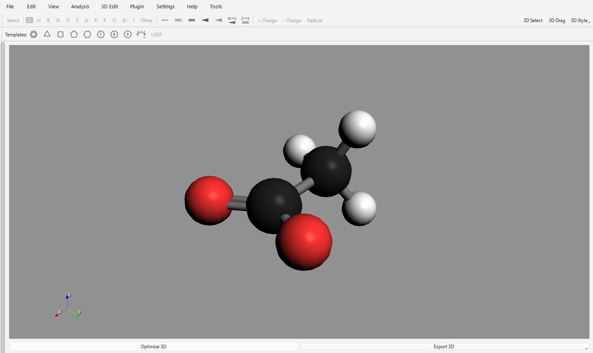

## 2. Solvate it

Open **Tools > MD System Builder...** and choose the **Solvate** tab. The settings used here:

| Setting | Value | Why |
|---|---|---|
| Box | Bounding box + padding, 15 Å, cubic | at least 15 Å of water on every side of the solute |
| Solvent | TIP3P water (pre-equilibrated box) | the water model Sage is parameterised with |
| Remove solvent within | 2.4 Å | no water overlapping the solute |
| Salt | NaCl, *Neutralise the solute charge* on | one extra Na+ cancels the -1 of acetate |
| Salt concentration | 0.15 mol/L | physiological salt |

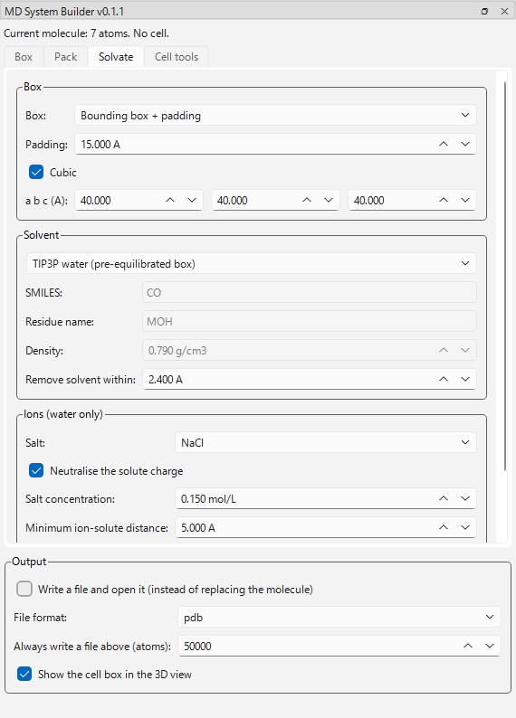

Press **Solvate**. The solvated system replaces the current molecule as one undo step,
with the periodic cell and the residue names the next plugins read. With more than 2,000
atoms, the Large System Viewer asks to switch to its fast style; answer **Yes**.

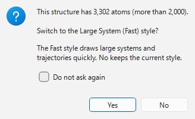

The result: 3,302 atoms in a 32.56 Å cubic box: the acetate (MOL), 1,096 waters (SOL),
4 Na+ and 3 Cl-. The yellow lines are the cell, and the toolbar at the bottom belongs
to the Large System Viewer.

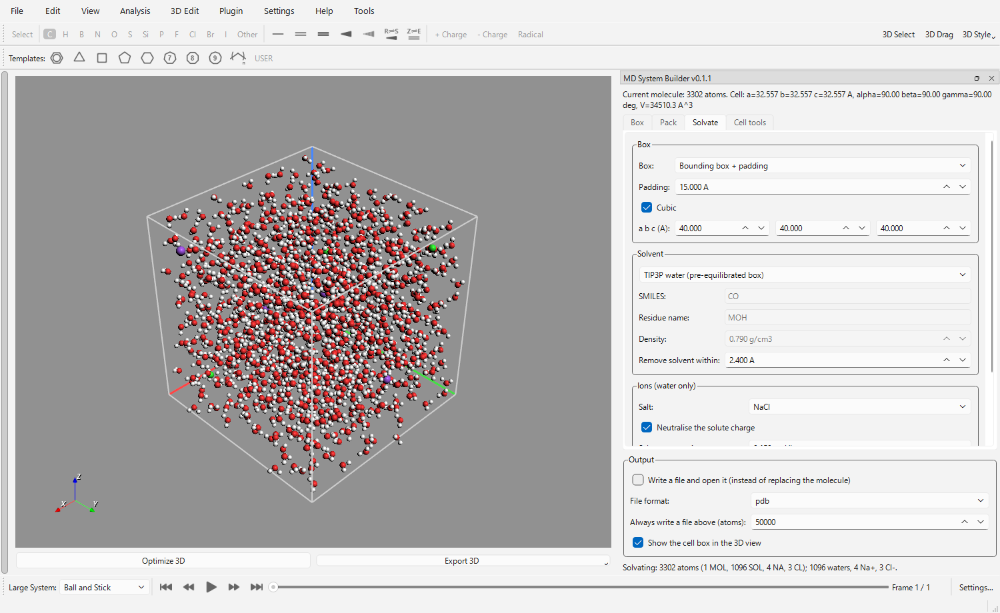

Check the box before going on: the solute should sit inside, with water all around it.

## 3. Assign the force field

Open **Tools > Force Field Builder...**. Keep **OpenFF Sage 2.3.0** (built in, no
installation needed), the charge method **Force field's own scheme**, the water model
**TIP3P**, and *Mark bonds to hydrogen as constraints*, then press **Assign Parameters**.

Every distinct molecule becomes one molecule type, so the 1,096 waters are parameterised
once. The table lists the four types with their copies, atoms and net charges; the total
is zero.

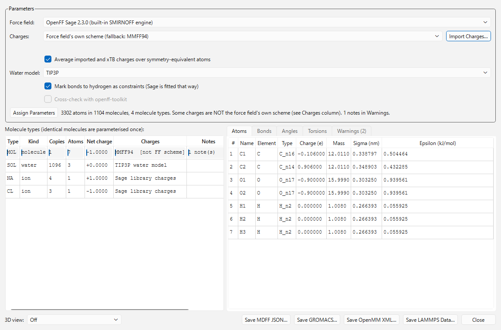

**Read the Warnings tab.** Sage's own charges for organic molecules are AM1-BCC. To
compute them the Force Field Builder needs either AmberTools (`sqm`, on Linux, macOS or
WSL, for example from conda-forge) or the `openff-nagl` package. Neither was installed on
the Windows machine used for these screenshots, so it fell back to MMFF94 charges, marked
the acetate `[not FF scheme]`, and said so here:

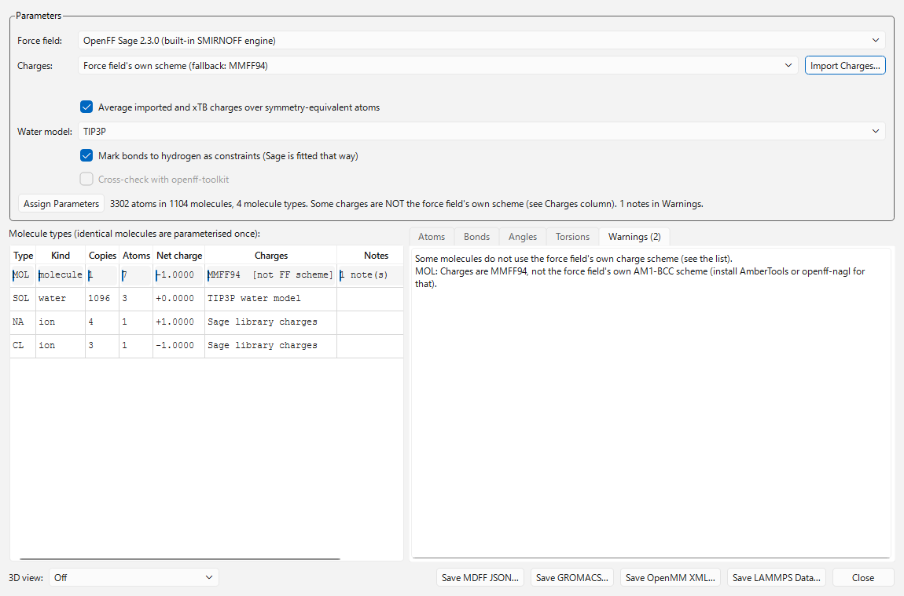

MMFF94 charges are fine for trying out the workflow. For production runs choose one of:

- install AmberTools or `openff-nagl` and press **Assign Parameters** again, which gives
  AM1-BCC charges;
- compute the solute alone with a QM program and load the output with
  **Import Charges...** (xtb, ORCA, PySCF, Q-Chem and Psi4 output is read; ESP-fitted and
  RESP charges are offered first, CM5, Hirshfeld and Mulliken after them). The charges are
  copied to every copy of that molecule in the box.

Water and ions always use the parameters that belong to the water model, so the charge
method only affects the solute.

Save the result with **Save MDFF JSON...** as `system.mdff.json`. This file holds every
parameter of the system and is what the MD input generators read.

## 4. Write the GROMACS input

Open **File > Export > GROMACS Input (.gro/.top/.mdp)...**. On the **Force field** tab,
press **Browse...** next to the force-field file and choose `system.mdff.json`. The
**System** tab then shows the four molecule types taken from that file, and the box taken
from the cell MD System Builder set. Every file is shown in the live preview on the right.

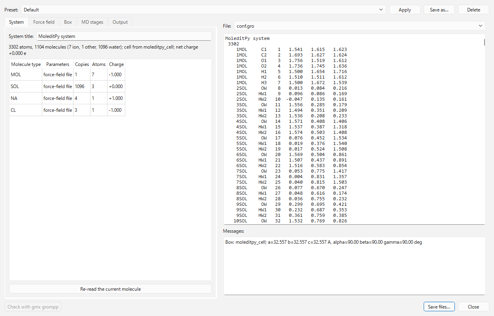

The **MD stages** tab holds the run protocol. The defaults were kept:

- energy minimisation (steepest descent);
- 100 ps NVT and 100 ps NPT equilibration;
- 1 ns production, with a 2 fs time step, bonds to hydrogen constrained, PME
  electrostatics, 1.0 nm cut-offs, V-rescale thermostat at 300 K, C-rescale barostat at
  1 bar, and coordinates written every 10 ps.

The **Quick test (10 ps per stage)** preset is useful for checking that a system runs at
all before a long job.

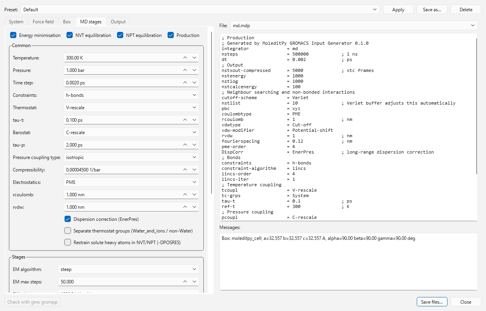

Press **Save files...** and choose an empty folder. It receives `conf.gro`, `topol.top`
with one `.itp` per molecule type, `em.mdp`, `nvt.mdp`, `npt.mdp`, `md.mdp`, `index.ndx`
and the run scripts `run.sh` and `run.bat`.

When `gmx` is on the PATH of the machine running MoleditPy, **Check with gmx grompp**
runs `grompp` on the files first.

## 5. Run GROMACS

Copy the folder to the machine with GROMACS and run the script. It runs `grompp` and
`mdrun` for each stage in order, each stage starting from the previous one's output:

```bash
source /path/to/gromacs/bin/GMXRC
bash run.sh
```

Use `GMX=gmx_mpi bash run.sh` for an MPI build, and `MDRUN_FLAGS` for extra `mdrun`
options, for example `MDRUN_FLAGS="-nb gpu"`.

In this example all four stages passed `grompp` without warnings and finished in 53 s
on one GPU (about 2,200 ns/day for the production stage). Over the 1 ns production run,
`gmx energy` gives:

| Quantity | Average |
|---|---|
| Temperature | 299.8 K |
| Density | 994.9 kg/m³ |
| Box edge after NPT | 31.98 Å |

The density is that of TIP3P water at 300 K and 1 bar, so the system equilibrated as
expected. The box shrank slightly from 32.56 Å during NPT, as it always does when a
water box is first equilibrated.

## 6. Play and analyse the trajectory

Convert the compressed trajectory to GRO, which MoleditPy reads. `-pbc mol` keeps the
molecules whole; `0` selects the whole system:

```bash
echo 0 | gmx trjconv -s md.tpr -f md.xtc -o md_traj.gro -pbc mol
```

That gives 101 frames (0 to 1 ns, 10 ps apart) in a 15 MB file. Open `md_traj.gro` in
MoleditPy with **File > Open** or by dropping it on the window. The Large System Viewer
reads the frames from the file as they are shown. Play them with the buttons and the
slider at the bottom.

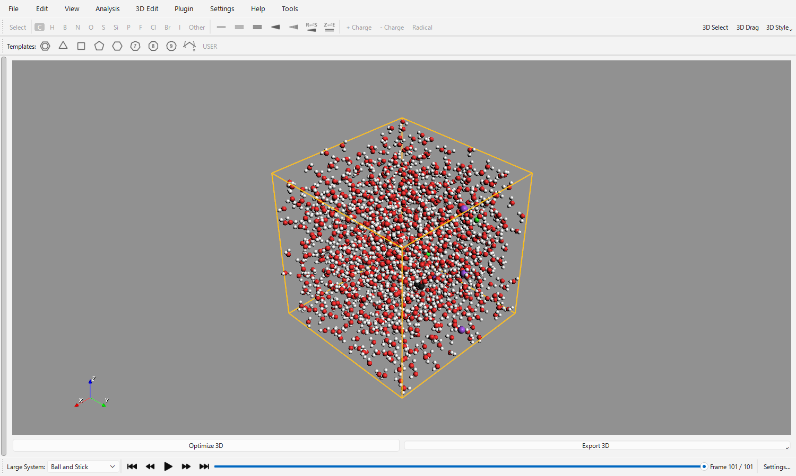

**Save GIF...** on the same toolbar writes the frames as an animated GIF. This one is the
whole 1 ns at one frame every 50 ps (21 frames), saved with High Quality and Transparent on
at 6 frames per second:

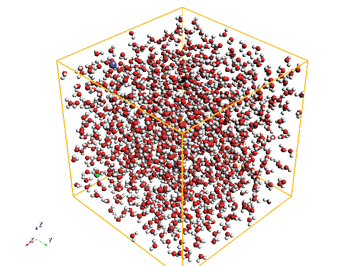

Then open **Analysis > Trajectory Analysis...**, choose the file and press **Load**. The cell
is read from the GRO box line of each frame.

**Radial distribution function.** With *Radial distribution function g(r)*, selection A
and B `name OW` (the water oxygens) and r max 12 Å, the first peak is at 2.79 Å with
g = 2.65. This is the hydrogen-bonded first shell of water, at the distance known from
experiment (about 2.8 Å).

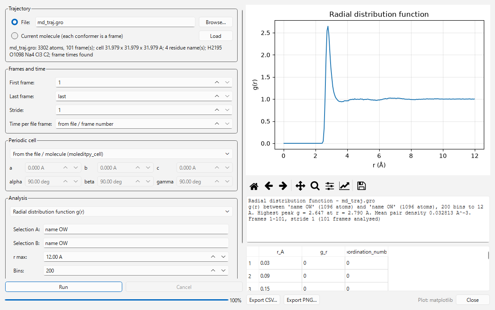

**Diffusion.** With *Mean square displacement / diffusion* and selection `name OW`, the
MSD grows linearly with time, and the fit gives D = 5.4 × 10⁻⁵ cm²/s. TIP3P water is
known to diffuse more than twice as fast as real water (2.3 × 10⁻⁵ cm²/s at 25 °C), and
this value matches what is usually reported for TIP3P with PME. It is a property of the
water model, not an error in the setup.

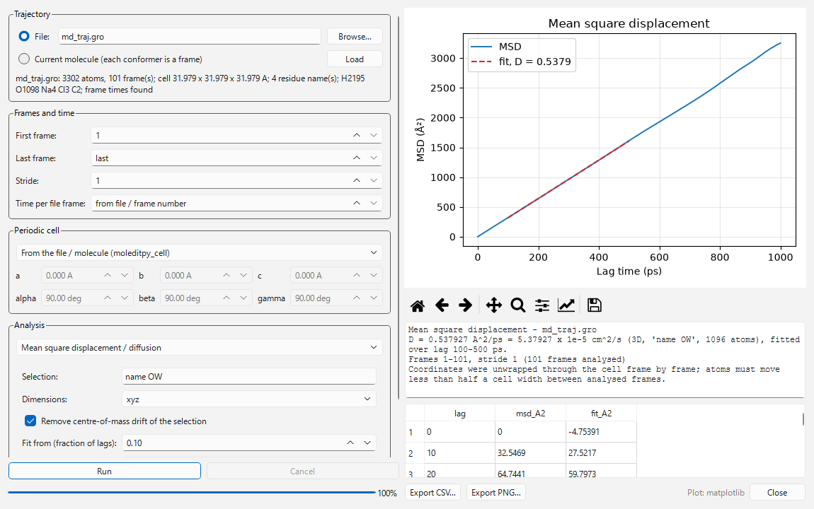

**Export CSV...** and **Export PNG...** save the data and the plot. RMSD and RMSF of the
solute, the radius of gyration and density profiles work the same way, with selections
such as `resname MOL` or `resname MOL and not hydrogen`.

## Where to go from here

- **Your own molecule**: the steps are the same. For a drug-like ligand, give it AM1-BCC
  or QM charges (step 3) rather than the MMFF94 fallback.
- **Mixtures and liquids**: use the **Pack** tab of MD System Builder instead of
  **Solvate**, by count or by density.
- **Other engines**: the same `system.mdff.json` feeds the
  [LAMMPS Input Generator](https://github.com/HiroYokoyama/moleditpy_lammps_input_generator)
  and the [OpenMM Script Generator](https://github.com/HiroYokoyama/moleditpy_openmm_script_generator).
- **Back to the overview**: [MD calculation prep on MoleditPy](../README.md#md-calculation-prep-on-moleditpy).
